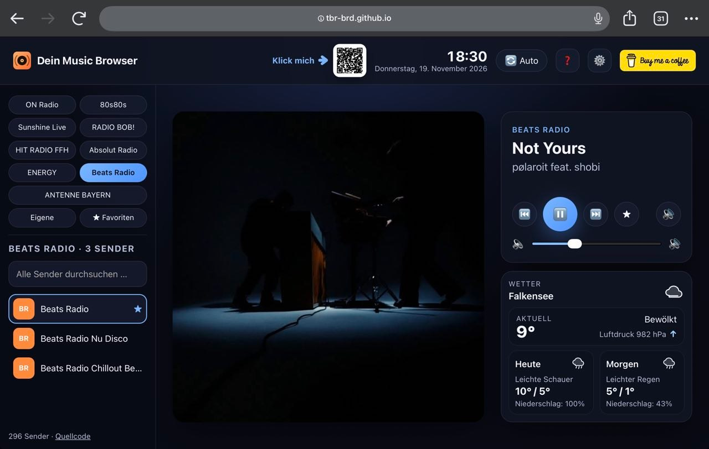
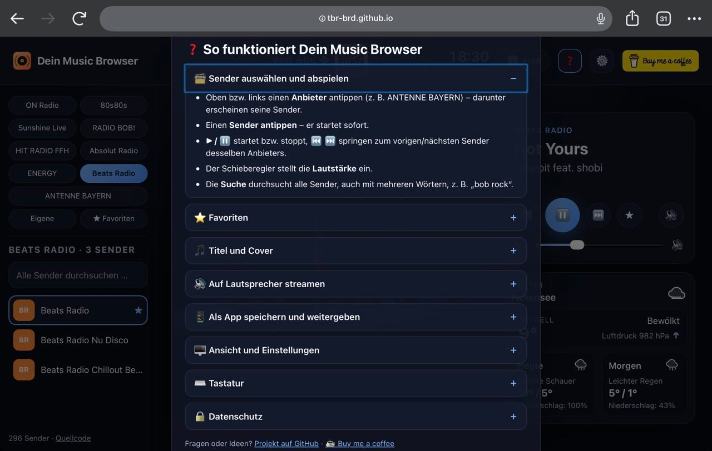
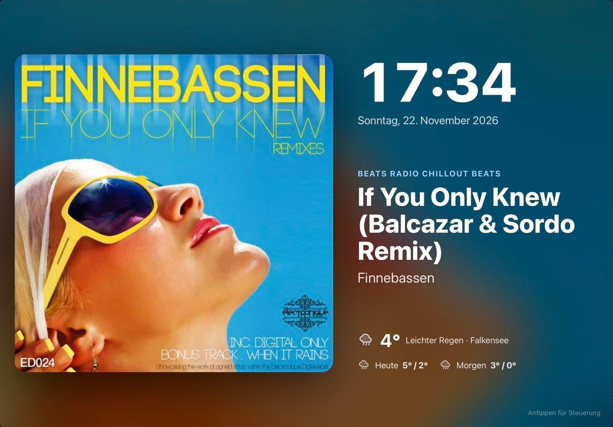
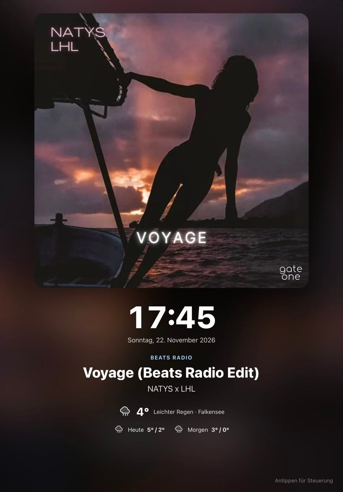

# Dein Music Browser

🇩🇪 Deutsch · [🇬🇧 English](README_EN.md)

Radio direkt im Browser: **rund 290 Sender** von 10 Anbietern, mit großem Albumcover, aktuellem Titel, Datum, Uhrzeit und Wetter. Abspielen kannst du im Browserfenster oder per **AirPlay und Chromecast** auf Lautsprechern.

Die Webseite ist rein statisch und läuft auf **GitHub Pages**, ohne eigenen Server und weltweit erreichbar.

**▶ Live-Version: [tbr-brd.github.io/music-browser](https://tbr-brd.github.io/music-browser/)**

<br>
<a href="https://www.buymeacoffee.com/thoralf.brandt" target="_blank">
  
</a>
<br>

## Screenshots

Auf dem iPad (Chrome, Vollansicht):





**Display-Modus 🖼️** – quer:



Hochkant:



## Funktionen

- **Anbieter-Buttons** (in der Vollansicht links über den Sendern): ON Radio, 80s80s, Sunshine Live, RADIO BOB!, HIT RADIO FFH, Absolut Radio, ENERGY, ANTENNE BAYERN, Beats Radio, Eigene und ★ Favoriten. Darunter stehen nur die Sender des gewählten Anbieters.
- **Suche** über alle Sender, auch mit mehreren Wörtern (z. B. „bob rock“)
- **Favoriten** per ☆ beim laufenden Sender
- **Großes Cover und aktueller Titel** bei 80s80s, RADIO BOB!, Sunshine Live, HIT RADIO FFH und ENERGY, direkt von deren Schnittstellen und sonst über die iTunes-Suche. Ohne laufenden Titel erscheint das Senderlogo des Anbieters.
- **Datum und Uhrzeit** oben rechts
- **Wetter** wie bei onradio-cover-bridge: aktuell mit Luftdruck und Tendenz (↑ → ↓), dazu Heute und Morgen mit Niederschlag (Open-Meteo)
- **QR-Code** oben rechts zum Weitergeben der Seite an Freunde; ein Klick vergrößert ihn
- **Als App speichern:** Wer die Seite über den QR-Code oder zum ersten Mal auf dem Handy öffnet, bekommt das Speichern auf dem Startbildschirm angeboten. Unter Android/Chrome genügt ein Tipp auf „Speichern“, auf iPhone/iPad erklärt der Hinweis den Weg über „Teilen → Zum Home-Bildschirm“. „Später“ blendet ihn für 30 Tage aus. Die Seite läuft dann wie eine App im Vollbild.
- **Zwei Ansichten:** Voll (Desktop/TV) und Mobil. Sie schalten sich automatisch nach Bildschirmbreite um. Der Button 🔄/🖥️/📱 schaltet zwischen Auto, Voll und Mobil.
- **🖼️ Display-Modus:** nur großes Cover, Titel, Interpret, Uhr, Datum und Wetter – ideal fürs iPad als Radio-Display. Antippen blendet die Steuerung ein (⏮ ▶ ⏭ ✕ Beenden), der Bildschirm bleibt an (Screen Wake Lock), wo erlaubt echtes Vollbild. Hochkant und quer jeweils mit eigenem Aufbau. Taste `D` startet, `Esc` beendet.
- **❓ Hilfe** oben rechts (oder Taste `?`/`F1`): Bedienungsanleitung mit aufklappbaren Abschnitten
- **Einstellungen:** Ort für das Wetter und Dunkel-/Hell-Modus
- **🔊 Lautsprecher-Button:** streamt auf Lautsprecher – per **AirPlay** auf iPhone, iPad und Mac (HomePod, Apple TV, AirPlay-2-Lautsprecher wie neuere Sonos), per **Chromecast/Google Cast** in Chrome und Edge am Computer und per Cast in Chrome auf Android. Bluetooth-Lautsprecher verbindet man im System, der Ton folgt automatisch.
- Medientasten und Sperrbildschirm-Anzeige (Media Session API), Leertaste für Play/Stopp

## Senderliste

Die Sender kommen live aus [radiostations](https://github.com/TBR-BRD/radiostations), dem gemeinsamen Katalog für dieses Projekt, die [Google-TV-App](https://github.com/TBR-BRD/googletv-musicplayer) und den [Raspberry Pi](https://github.com/TBR-BRD/onradio-cover-bridge). Ein neuer Sender wird dort einmal eingetragen und erscheint dann überall. Die Gruppe „Other stations“ heißt hier **Eigene**.

## Wo werden Favoriten und Einstellungen gespeichert?

Nur **im Browser** (`localStorage`), nicht auf einem Server. Sie bleiben erhalten, bis du die Websitedaten löschst. Auf einem anderen Gerät oder in einem anderen Browser fängst du mit leeren Favoriten an.

## Warum zeigen manche Sender keinen Titel?

Eine Webseite darf Daten fremder Server nur lesen, wenn der Anbieter das erlaubt (CORS). Die Google-TV-App und der Raspberry Pi sind eigene Programme, für sie gilt diese Sperre nicht.

| Anbieter | Titel und Cover im Browser |
|---|---|
| 80s80s, RADIO BOB!, Sunshine Live, HIT RADIO FFH, ENERGY | ✅ direkt über deren Schnittstellen |
| ON Radio | ✅ 7 Sender direkt, die übrigen über den Helfer |
| ANTENNE BAYERN | ✅ über den Helfer, mit Cover von antenne.de |
| Eigene | ✅ über den Helfer (Titel bzw. laufende Sendung aus dem Stream) |
| Beats Radio | ✅ direkt über streamABC, mit Cover |
| Absolut Radio | ❌ der Sender liefert keine Titel – es erscheint das Senderlogo |

Für die Anbieter, die fremde Webseiten sperren, nutzt die Seite einen kleinen **Helfer**: den kostenlosen Cloudflare Worker aus [`proxy/worker.js`](proxy/worker.js). Er holt die Titel ab und gibt sie nur an diese Seite weiter (Adresse in `js/config.js` → `METADATA_PROXY`). Wer die Seite forkt, richtet sich einen eigenen Worker ein oder lässt `METADATA_PROXY` leer – dann fehlen nur bei diesen Anbietern die Titel.

## Installation auf GitHub Pages

1. Repository forken oder die Dateien in ein eigenes Repository hochladen.
2. **Settings → Pages**: Source „Deploy from a branch“, Branch `main`, Ordner `/ (root)`.
3. Nach ein bis zwei Minuten läuft die Seite unter `https://<name>.github.io/music-browser/`.

## Lokal testen

```bash
python3 -m http.server 8000
# http://localhost:8000 öffnen
```

## Repository-Struktur

```text
index.html          Seite
css/style.css       Gestaltung: Dunkel/Hell, Voll- und Mobilansicht
js/app.js           Oberfläche, Wiedergabe, Ansicht, Einstellungen
js/config.js        Gruppennamen, direkte Stream-Adressen, optionaler Helfer
js/stations.js      Senderliste laden (mit Offline-Kopie)
js/metadata.js      Titel, Interpret, Cover (80s80s, BOB, Sunshine Live, FFH, ENERGY)
js/cover.js         Cover-Suche (iTunes) und Platzhalter
js/weather.js       Wetter (Open-Meteo)
assets/             Icon, QR-Code, Wettersymbole (aus onradio-cover-bridge)
docs/screenshots/   Screenshots für die README
js/cast.js          Google Cast
js/speakers.js      Lautsprecher-Button (AirPlay, Cast, Remote Playback)
js/display.js       Display-Modus (Vollbild, Bildschirm bleibt an)
js/storage.js       Einstellungen und Favoriten (localStorage)
js/install.js       Angebot „Als App speichern“
manifest.webmanifest, sw.js   Installierbare Web-App (PWA)
proxy/worker.js     Optionaler Metadaten-Helfer (Cloudflare Worker)
```

## Geplante Erweiterungen

- **Werbepausen bei Beats Radio erkennen (optional):** Die streamABC-Metadaten der drei Beats-Radio-Sender melden Werbung nicht direkt, liefern aber Startzeit und Länge jedes Titels. Ist die berechnete Endzeit überschritten und noch kein neuer Titel gemeldet, läuft sehr wahrscheinlich eine Werbepause. Idee: ein Schalter in den Einstellungen (standardmäßig **aus**), der dann „Werbepause“ anzeigt und auf Wunsch stummschaltet, bis der nächste Titel kommt. Offene Punkte: Der Stream läuft einige Sekunden hinter den Metadaten her (Puffer nötig), Jingles und Moderation würden mit erfasst, und die Nutzungsbedingungen der Sender sind zu beachten.

## Datenschutz

Es gibt keinen eigenen Server und kein Tracking. Die Seite lädt nur die Streams und Titel der Radiosender, Cover von iTunes und das Wetter von Open-Meteo. Einstellungen und Favoriten bleiben in deinem Browser.

## Lizenz

MIT, siehe [LICENSE](LICENSE). Senderlogos, Cover und Streams gehören den jeweiligen Rechteinhabern.
