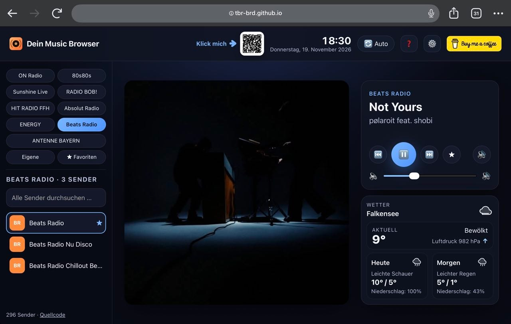
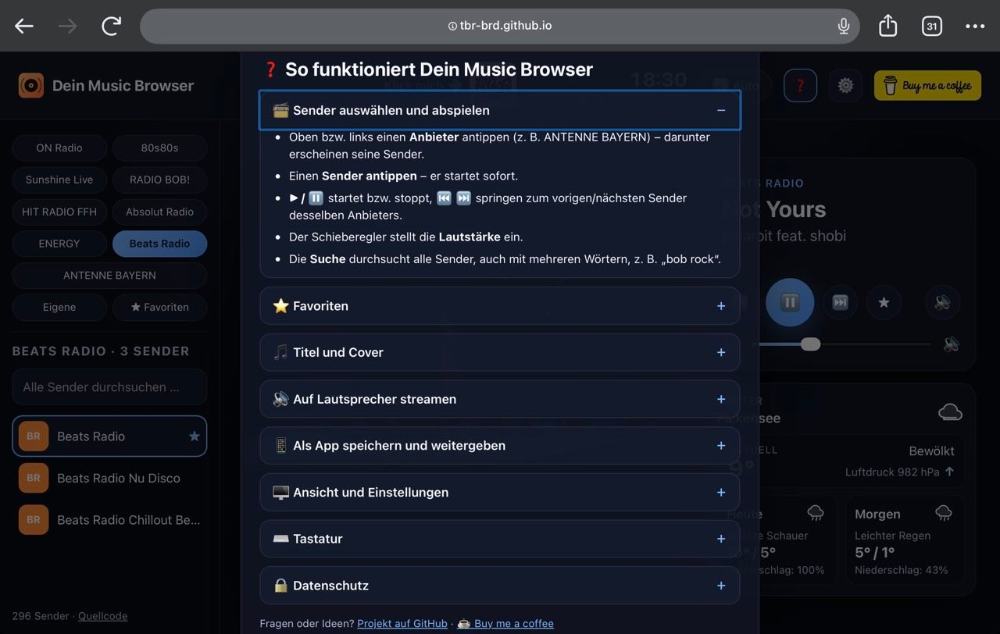
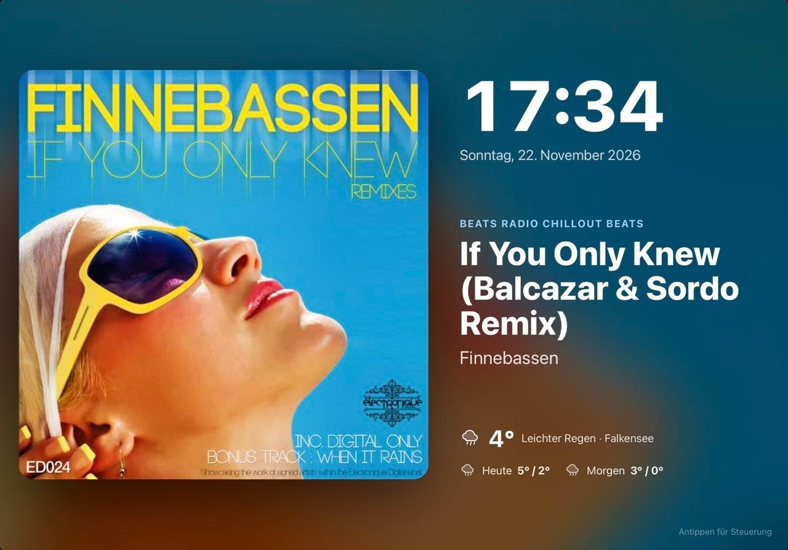
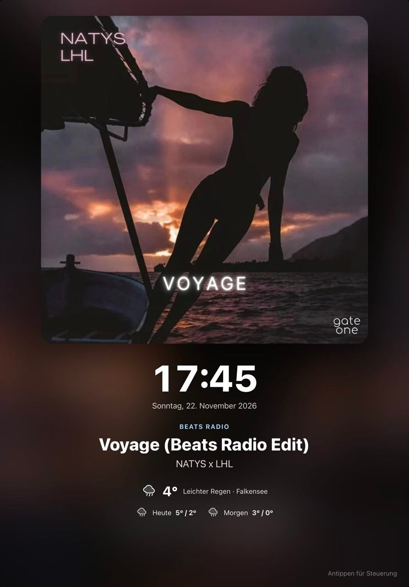

# Dein Music Browser

[🇩🇪 Deutsch](README.md) · 🇬🇧 English

Radio right in your browser: **around 290 stations** from 10 providers, with large album art, the current track, date, time and weather. Play in the browser window or on speakers via **AirPlay and Chromecast**.

The site is purely static and runs on **GitHub Pages**: no server of your own, reachable worldwide.

**▶ Live version: [tbr-brd.github.io/music-browser](https://tbr-brd.github.io/music-browser/)**

<br>
<a href="https://www.buymeacoffee.com/thoralf.brandt" target="_blank">
  
</a>
<br>

## Screenshots

On the iPad (Chrome, full view):





**Display mode 🖼️** – landscape:



Portrait:



## Features

- **Provider buttons** (in the full view on the left above the stations): ON Radio, 80s80s, Sunshine Live, RADIO BOB!, HIT RADIO FFH, Absolut Radio, ENERGY, ANTENNE BAYERN, Beats Radio, TV, Deluxe Music TV, Eigene (own stations) and ★ Favoriten (favorites). Only the selected provider's stations are listed below.
- **📺 TV:** German public channels (Das Erste, ZDF, 3sat, ARTE, ZDFneo, ZDFinfo, phoenix, tagesschau24, ARD alpha, KiKA and the regional channels of BR, hr, MDR, NDR, Radio Bremen, rbb, SR, SWR, WDR) via their official livestreams. Many of them are only available in Germany. Private channels such as RTL, Sat.1 or ProSieben are not freely available as streams.
- **📺 Live TV DELUXE MUSIC:** Under "Deluxe Music TV" the music TV channels play in the station's official player in place of the cover (volume and fullscreen inside the player). Included are DELUXE MUSIC, Schlager Deluxe and Deluxe Dance by Kontor; Deluxe Rap and Deluxe Lounge only show trailers on deluxemusic.de.
- **Search** across all stations, including multiple words (e.g. "bob rock")
- **Favorites** via ☆ on the playing station
- **Large cover and current track** for 80s80s, RADIO BOB!, Sunshine Live, HIT RADIO FFH and ENERGY, straight from their APIs, otherwise via the iTunes search. Without a current track, the provider's station logo is shown.
- **Date and time** at the top right
- **Weather** as in onradio-cover-bridge: current conditions with air pressure and trend (↑ → ↓), plus today and tomorrow with precipitation (Open-Meteo)
- **QR code** at the top right for sharing the site with friends; click to enlarge
- **Save as an app:** Opening the site via the QR code, or on a phone for the first time, shows an offer to save it to the home screen. On Android/Chrome one tap on "Speichern" (save) is enough; on iPhone/iPad the hint explains the way via "Share → Add to Home Screen". "Später" (later) hides it for 30 days. The site then runs full-screen like an app.
- **Two views:** full (desktop/TV) and mobile. They switch automatically by screen width; the 🔄/🖥️/📱 button cycles through auto, full and mobile.
- **🖼️ Display mode:** just a large cover, title, artist, clock, date and weather – ideal for an iPad as a radio display. Tap to show the controls (⏮ ▶ ⏭ ✕ Exit); the screen stays on (Screen Wake Lock) and goes true fullscreen where allowed. Separate layouts for portrait and landscape. Key `D` starts it, `Esc` exits.
- **❓ Help** at the top right (or `?`/`F1` key): user guide with expandable sections (in German)
- **Settings:** weather location and dark/light mode
- **🔊 Speaker button:** streams to speakers – via **AirPlay** on iPhone, iPad and Mac (HomePod, Apple TV, AirPlay 2 speakers such as newer Sonos), via **Chromecast/Google Cast** in Chrome and Edge on the computer, and via Cast in Chrome on Android. Bluetooth speakers are connected in the operating system; audio follows automatically.
- Media keys and lock-screen info (Media Session API); space bar = play/stop

## Home Assistant

As a card for the Home Assistant dashboard (radio, live TV, weather; audio on the device or via AirPlay): **[homeassistant-music-browser](https://github.com/TBR-BRD/homeassistant-music-browser)**. The card uses the building blocks of this web app straight from GitHub Pages.

## Station list

Stations are loaded live from [radiostations](https://github.com/TBR-BRD/radiostations), the shared catalog for this project, the [Google TV app](https://github.com/TBR-BRD/googletv-musicplayer) and the [Raspberry Pi](https://github.com/TBR-BRD/onradio-cover-bridge). Add a station there once and it shows up everywhere. The group "Other stations" is called **Eigene** here.

## Where are favorites and settings stored?

Only **in the browser** (`localStorage`), not on a server. They stay until you clear the site data. On another device or in another browser you start with empty favorites.

## Why do some stations show no track title?

A web page may only read data from other servers if the provider allows it (CORS). The Google TV app and the Raspberry Pi are standalone programs, so this restriction doesn't apply to them.

| Provider | Title and cover in the browser |
|---|---|
| 80s80s, RADIO BOB!, Sunshine Live, HIT RADIO FFH, ENERGY | ✅ directly from their APIs |
| ON Radio | ✅ 7 stations directly, the rest via the helper |
| ANTENNE BAYERN | ✅ via the helper, with covers from antenne.de |
| Eigene | ✅ via the helper (track or current show from the stream) |
| Beats Radio | ✅ directly via streamABC, with covers |
| Absolut Radio | ❌ the station sends no track titles – its logo is shown instead |

For providers that block other websites, the site uses a small **helper**: the free Cloudflare Worker in [`proxy/worker.js`](proxy/worker.js). It fetches the titles and passes them only to this site (address in `js/config.js` → `METADATA_PROXY`). If you fork the site, set up your own worker or leave `METADATA_PROXY` empty – then only these providers lack titles.

### Allowing more sites (e.g. Home Assistant)

The worker only answers sites listed in the variable `ALLOWED_ORIGINS` (without the variable only `https://tbr-brd.github.io`). To add more addresses, e.g. for the [Home Assistant card](https://github.com/TBR-BRD/homeassistant-music-browser):

1. [dash.cloudflare.com](https://dash.cloudflare.com) → **Compute (Workers) → Workers & Pages** → worker **`music-proxy`**.
2. **Settings** tab → **Variables and Secrets** → **+ Add**.
3. Keep **Production** checked, **Key** `ALLOWED_ORIGINS`, **Value** all addresses comma-separated, leave **Secret** unchecked:
   ```
   https://tbr-brd.github.io,http://192.168.42.179:8123
   ```
4. Click **Add variable and deploy**.
5. Check: [music-proxy.cloudflare-radio.workers.dev](https://music-proxy.cloudflare-radio.workers.dev/) lists all addresses under `allowedOrigins`.

Enter addresses exactly as shown in the address bar (with `http://` or `https://` and port, without a trailing `/`).

## Hosting on GitHub Pages

1. Fork the repository or upload the files to your own repository.
2. **Settings → Pages**: source "Deploy from a branch", branch `main`, folder `/ (root)`.
3. After a minute or two the site is live at `https://<name>.github.io/music-browser/`.

## Local testing

```bash
python3 -m http.server 8000
# open http://localhost:8000
```

## Repository structure

```text
index.html          Page
css/style.css       Styling: dark/light, full and mobile views
js/app.js           UI, playback, view switching, settings
js/config.js        Group names, direct stream URLs, optional helper
js/stations.js      Load station list (with offline copy)
js/metadata.js      Title, artist, cover (80s80s, BOB, Sunshine Live, FFH, ENERGY)
js/cover.js         Cover search (iTunes) and placeholders
js/weather.js       Weather (Open-Meteo)
assets/             Icon, QR code, weather icons (from onradio-cover-bridge)
docs/screenshots/   Screenshots for the README
js/cast.js          Google Cast
js/speakers.js      Speaker button (AirPlay, Cast, Remote Playback)
js/display.js       Display mode (fullscreen, screen stays on)
js/storage.js       Settings and favorites (localStorage)
js/install.js       "Save as app" offer
manifest.webmanifest, sw.js   Installable web app (PWA)
proxy/worker.js     Optional metadata helper (Cloudflare Worker)
```

## Planned extensions

- **Detect ad breaks on Beats Radio (optional):** The streamABC metadata of the three Beats Radio channels does not flag ads directly, but it provides each track's start time and duration. If the computed end time has passed and no new track has been reported, an ad break is most likely playing. Idea: a switch in the settings (**off** by default) that then shows "Ad break" and optionally mutes until the next track starts. Open points: the stream lags a few seconds behind the metadata (needs a buffer), jingles and presenter breaks would be caught too, and the stations' terms of use must be respected.

## Privacy

There is no server of its own and no tracking. The site only loads the stations' streams and titles, covers from iTunes and the weather from Open-Meteo. Settings and favorites stay in your browser.

## License

MIT, see [LICENSE](LICENSE). Station logos, cover art and streams belong to their respective rights holders.
